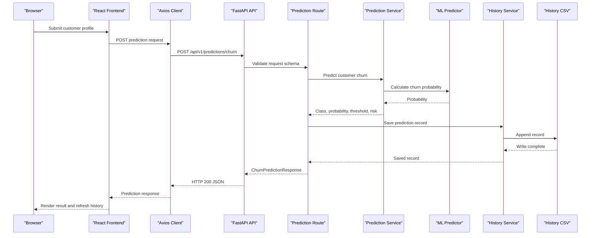

# API & Service Communication Contracts

The project exposes 17 unique versioned API endpoints and one root information endpoint. The browser and API communicate synchronously over HTTP/JSON; internal API routes call in-process services and use local artifacts.

## Service Catalog

| Service | Port | Category | Purpose |
|---|---:|---|---|
| `frontend` (`churn-dashboard`) | Container 80; host 5173 | API Client / Presentation | Serves the React dashboard using Nginx and calls the backend |
| `backend` (FastAPI application) | 8000 | API Layer | Serves prediction, analytics, model reporting, history, and health routes |
| ML package (`ml/churn_model`) | In-process, not independently deployed | Business | Loads the model and calculates prediction results for the API |
| Analytics and reporting modules | In-process, not independently deployed | Business | Read processed data and saved metrics/evaluation files for API responses |

The Docker Compose file defines two independently run containers, `backend` and `frontend`. The ML and API service modules are code modules in the backend container, not separate network services.

## API Endpoints Inventory

| Service | Method | Path | Request Type | Response Type |
|---|---|---|---|---|
| FastAPI | GET | `/` | None | Root metadata object |
| FastAPI | GET | `/api/v1/health` | None | Health status object |
| FastAPI | POST | `/api/v1/predictions/churn` | `ChurnPredictionRequest` JSON body | `ChurnPredictionResponse`; HTTP 200 |
| FastAPI | GET | `/api/v1/predictions/history` | Query `limit` (default 100, range 1-1000) | `PredictionHistoryResponse` |
| FastAPI | GET | `/api/v1/analytics/summary` | None | `AnalyticsSummaryResponse` |
| FastAPI | GET | `/api/v1/analytics/business-insights` | None | `list[BusinessInsightItem]` |
| FastAPI | GET | `/api/v1/analytics/churn-distribution` | None | `list[ChurnDistributionItem]` |
| FastAPI | GET | `/api/v1/analytics/contract-churn` | None | `list[ContractChurnItem]` |
| FastAPI | GET | `/api/v1/analytics/tenure-distribution` | None | `list[TenureDistributionItem]` |
| FastAPI | GET | `/api/v1/analytics/tenure-churn` | None | `list[TenureChurnItem]` |
| FastAPI | GET | `/api/v1/analytics/internet-service-churn` | None | `list[InternetServiceChurnItem]` |
| FastAPI | GET | `/api/v1/analytics/monthly-charges-churn` | None | `list[MonthlyChargesChurnItem]` |
| FastAPI | GET | `/api/v1/analytics/payment-method-churn` | None | `list[PaymentMethodChurnItem]` |
| FastAPI | GET | `/api/v1/model/metrics` | None | `ModelMetricsResponse` |
| FastAPI | GET | `/api/v1/model/info` | None | `ModelInfoResponse` |
| FastAPI | GET | `/api/v1/model/confusion-matrix` | None | `ConfusionMatrixResponse` |
| FastAPI | GET | `/api/v1/model/roc-curve` | None | `RocCurveResponse` |
| FastAPI | GET | `/api/v1/model/feature-importance` | None | `FeatureImportanceResponse` |

FastAPI documentation endpoints: `/docs`, `/redoc`, and `/openapi.json`. These are generated documentation resources, not business endpoints.

## Management & Observability Endpoints

| Service | Endpoint | Custom Metrics (if any) |
|---|---|---|
| FastAPI | `GET /api/v1/health` | None identified |
| FastAPI | `GET /` | None; basic API information |
| FastAPI | `GET /docs`, `/redoc`, `/openapi.json` | None; generated API documentation |
| FastAPI | Request logging middleware | Logs method, path, status code, and elapsed milliseconds; no exported metric name identified |

## DTOs & Contracts

The Pydantic schemas define typed API payload objects and are mutable by default; none is configured as a frozen model. `ChurnPredictionRequest` is the prediction request body; `ChurnPredictionResponse` is its response. `PredictionHistoryResponse` wraps `PredictionHistoryItem` records. Analytics contracts include `AnalyticsSummaryResponse`, `BusinessInsightItem`, `ChurnDistributionItem`, `ContractChurnItem`, `TenureDistributionItem`, `InternetServiceChurnItem`, `PaymentMethodChurnItem`, `MonthlyChargesChurnItem`, and `TenureChurnItem`. Model reporting uses `ModelMetricsResponse` and `ModelMetrics`; `ModelInfoResponse`, `ConfusionMatrixResponse`, `RocCurveResponse`, `RocPoint`, `FeatureImportanceResponse`, and `FeatureImportanceItem` represent evaluation artifacts. Root and health routes return dictionaries inferred by FastAPI.

No API gateway aggregation DTO, GraphQL schema, or protobuf schema was identified. FastAPI generates OpenAPI at `/openapi.json` with Swagger UI at `/docs` and ReDoc at `/redoc`. JSON serialization is handled by FastAPI/Pydantic; no custom serializer configuration was identified. See `data-architecture.md` for persistence and data details.

## Communication Patterns

- **Synchronous request path:** browser React components call frontend service functions through Axios; requests are sent as HTTP/JSON to FastAPI. Routes call prediction, analytics, metrics, evaluation, or history services directly within the backend process.
- **Asynchronous messaging:** no queue, broker, event, or pub/sub mechanism was identified.
- **Resilience:** frontend Axios timeout is configured to 15 seconds. No circuit breaker or explicit retry policy was found. Prediction success invalidates the frontend history query; this is cache refresh behavior, not guaranteed request retry.
- **Gateway aggregation:** no separate API gateway or multi-service response composition was found. A single backend endpoint delegates to a local service; prediction additionally persists a history row before responding.
- **Service discovery/load balancing:** no service registration or client-side load balancer is present in inspected configuration. Docker Compose service connectivity is used at deployment.
- **Security posture:** CORS is configured for `http://localhost:5173` and `http://127.0.0.1:5173`. No API authentication or authorization configuration was identified. Local Compose publishes HTTP ports; TLS termination is not defined in the inspected files.
- **Operational note:** Dockerfile health check path is `/health`, whereas the API health route is `/api/v1/health`; Compose uses the latter. The metrics router is also included twice in FastAPI setup.

## Service Technology Matrix

| Service | Web | Data Access | Discovery | Gateway | Health | Cache | Metrics |
|---|---|---|---|---|---|---|---|
| Frontend | Nginx static server, React | HTTP API via Axios | None | No | No backend health probe of its own | React Query client cache | None identified |
| Backend | FastAPI / Uvicorn | CSV and local artifact files | Docker Compose networking | No | Custom `/api/v1/health` | None identified | Request logging; no metrics exporter identified |
| ML package | In-process Python module | Serialized model and metadata | Not applicable | No | Not applicable | Model loaded by service | None identified |

## Service Communication Sequence

<!-- mermaid-checked: every participant uses `participant Id as "Label"`, no \n in aliases/messages/notes, every alt/opt/loop closed by end, no `:` inside any alias -->

