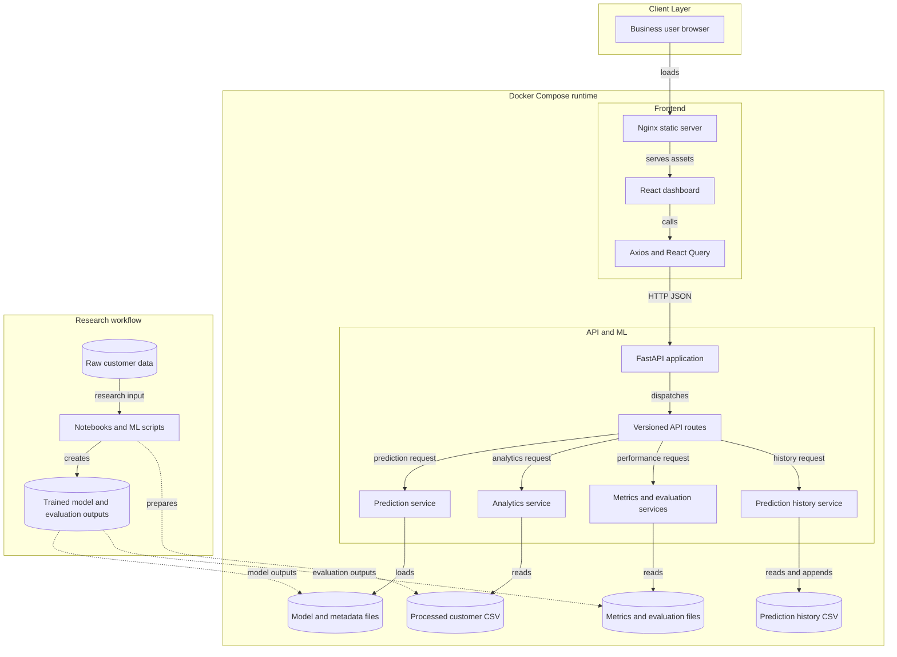
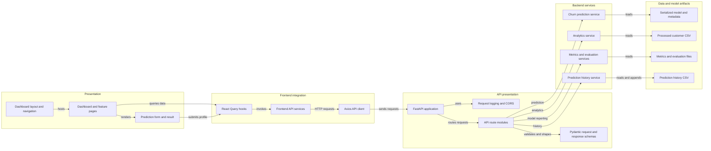

# Architecture Diagram

The application runs as a browser dashboard backed by a REST API and local model/data artifacts. A separate research workflow prepares the data and model artifacts consumed by the API.

## Application Architecture

<!-- mermaid-checked: no \n, no em-dash/en-dash, no {} in labels, subgraphs are id["label"], arrows are -->|"label"|, all subgraphs closed by end, ids unique -->

### Technology Stack Summary

| Layer | Technology | Version | Purpose |
|---|---|---|---|
| Frontend | React, TypeScript, Vite | React `19.2.8`, TypeScript `~6.0.2`, Vite `^8.2.0` | Browser dashboard |
| Frontend requests | Axios, TanStack Query | Axios `^1.19.0`, Query `^5.102.1` | API calls and request-state management |
| Web serving | Nginx | Alpine tag, exact version not pinned | Serves built frontend assets |
| Backend | Python, FastAPI, Uvicorn | Python `3.14`, FastAPI `0.141.1`, Uvicorn `0.52.4` | REST API runtime |
| ML and data | scikit-learn, pandas, joblib | scikit-learn `1.9.0`, pandas `3.0.5`, joblib `1.5.3` | Inference and file-based data/model operations |
| Container orchestration | Docker Compose | Not pinned | Runs frontend and backend containers |

### Data Storage & External Services

Runtime state is file-based: the API loads a serialized model and metadata, reads processed customer data and saved evaluation artifacts, and appends prediction history to CSV. Docker Compose persists the prediction-history directory through a host volume. No relational database, cache, message broker, or external API integration was identified in the reviewed runtime configuration.

### Key Architectural Decisions

- The API separates route handling from prediction, analytics, model-reporting, and history service responsibilities.
- The built React application is served separately from the Python API; communication between them is synchronous HTTP/JSON.
- Research and training outputs are consumed as files rather than through a model registry or online training service.

## Component Relationships

<!-- mermaid-checked: no \n, no em-dash/en-dash, no {} in labels, subgraphs are id["label"], arrows are -->|"label"|, all subgraphs closed by end, ids unique -->

### Component Inventory

| Component | Layer | Type | Responsibility |
|---|---|---|---|
| Dashboard layout and navigation | Presentation | React layout components | Provides shared page layout and navigation |
| Dashboard and feature pages | Presentation | React pages | Renders dashboard, analytics, model performance, and history views |
| Prediction form and result | Presentation | React components | Collects a profile and displays the API response |
| React Query hooks | Frontend integration | Data hooks | Loads API data and refreshes history after a successful prediction |
| Frontend API services | Frontend integration | Service functions | Maps UI operations to backend endpoints |
| Axios API client | Frontend integration | HTTP client | Applies base URL, JSON headers, timeout, and error logging |
| FastAPI application | API presentation | ASGI application | Configures routers, middleware, and API documentation |
| Request logging and CORS | API presentation | Middleware | Logs request outcomes and permits configured local browser origins |
| API route modules | API presentation | HTTP routers | Exposes prediction, analytics, metrics, history, and health operations |
| Pydantic request and response schemas | API presentation | Data contracts | Defines API payload validation and response structures |
| Churn prediction service | Backend services | Application service | Validates features and coordinates model scoring and thresholding |
| Analytics service | Backend services | Application service | Computes dashboard and segment summaries |
| Metrics and evaluation services | Backend services | Application services | Loads saved model metrics and evaluation outputs |
| Prediction history service | Backend services | File-backed service | Persists and retrieves prediction records |
| Model and metadata files | Data and model artifacts | Serialized artifacts | Supply the estimator and its inference threshold/metadata |
| Processed customer CSV | Data and model artifacts | Dataset | Supplies records for aggregate analytics |
| Metrics and evaluation files | Data and model artifacts | Saved outputs | Supply model-performance charts and measures |
| Prediction history CSV | Data and model artifacts | Runtime file | Stores records created by prediction requests |
